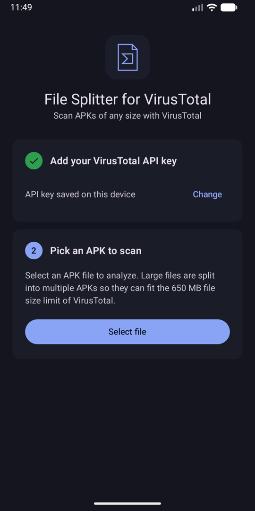
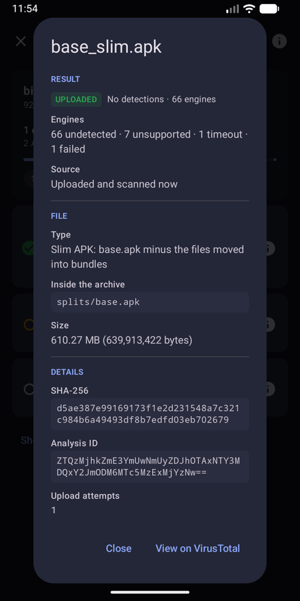
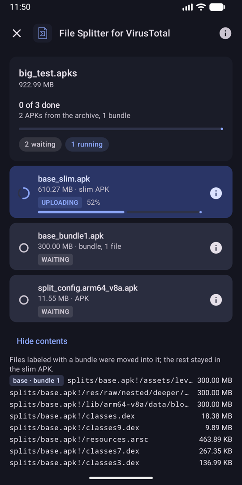
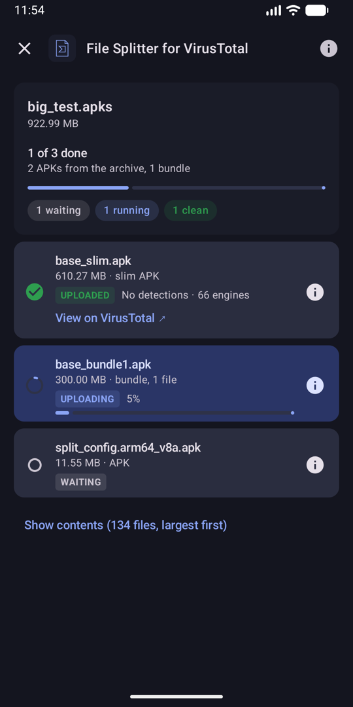

<p align="center">
  
</p>

<h1 align="center">File Splitter for VirusTotal</h1>

<p align="center">
  <b>Scan APKs of any size with VirusTotal, right from your Android phone.</b><br>
  Too big for the 650 MB upload limit? It splits them into scannable pieces automatically.
</p>

<p align="center">
  
  
  <a href="LICENSE"></a>
</p>

<p align="center">
  <sub>Unofficial. Not affiliated with or endorsed by VirusTotal or Google. "VirusTotal" and its logo are
  trademarks of their owners. Bring your own free VirusTotal API key.</sub>
</p>

<p align="center">
  
  
  
  
</p>

## Features

- 🧩 **Splits oversized APKs:** anything over 650 MB becomes a slim APK plus as few bundle APKs as
  possible, each still analyzed by VirusTotal as an Android package.
- 📦 **`.apks` support:** split-APK archives are opened and every APK inside is scanned.
- ⚡ **Hash first, upload second:** files VirusTotal already knows are answered instantly by SHA-256.
- 🚦 **Respects the free API:** 4 requests/minute, with automatic retries for quota and network errors.
- 🔁 **Resilient queue:** one file at a time, per-file Retry, "Retry failed", and a pause-and-fix
  banner for a rejected API key.
- 🌙 **Works in the background:** progress notification, and saved progress you can **Resume** after
  the app is closed.
- 🔒 **Private:** your API key never leaves the device, and the app talks only to `virustotal.com`.

## How it works

1. Save your VirusTotal API key (stored on the device only) and pick an APK or `.apks` archive.
2. **Under 650 MB:** the APK is submitted as-is.
3. **Over 650 MB:** the largest files are moved out until the rest fits, producing:
   - a **slim APK** with everything else, and
   - **bundle APKs** (up to 650 MB each) holding the moved files at their original paths, plus the
     original `AndroidManifest.xml` so VirusTotal still analyzes them as APKs. Files are packed
     into as few bundles as possible.
4. **`.apks` archives** (bundletool, SAI): each APK inside is handled the same way and named after
   itself, e.g. `base.apk`, or `base_slim.apk` + `base_bundle1.apk` when it's too big. Archive
   metadata (`toc.pb`, icons, JSON) isn't uploaded.
5. Files are processed one at a time: SHA-256 → hash lookup → upload only if VirusTotal doesn't
   know the file yet → wait for the analysis.

Each row shows its status (waiting, running, clean, detections, error), whether the result came
from an **upload** or a **hash match**, a link to the VirusTotal report, and Retry when it failed.

An APK is a zip file, so splitting never decompiles anything: entries are copied as they are.
Slim and bundle APKs aren't re-signed; they're for scanning, not installing.

## Build

Requirements: Android Studio (or JDK 21 and the Android SDK) and a device or emulator with
Android 8.0 or newer.

```bash
./gradlew :app:installDebug      # build and install a debug build on the connected device
./gradlew :app:assembleRelease   # release build (signed if keystore.properties exists)
```

### Release builds

Release builds are signed with the key described in `keystore.properties` at the repo root
(gitignored; never commit it or the keystore):

```properties
storeFile=/absolute/path/to/release.jks
storePassword=…
keyAlias=…
keyPassword=…
```

Create a key once with
`keytool -genkeypair -keystore release.jks -alias <alias> -keyalg RSA -keysize 4096 -validity 10000`,
and back it up: updates must be signed with the same key.

To publish a GitHub release (needs the [GitHub CLI](https://cli.github.com), logged in), run this
from a terminal with everything committed and pushed:

```bash
./gradlew publishGithubRelease   # or: scripts/release.sh; DRY_RUN=1 changes nothing on GitHub
```

It builds and verifies the signed APK, uploads it as release `v<versionName>` (asking before
replacing an existing one), then offers to bump the version for the next release.

## Test files

`scripts/make_test_apk.sh` builds test APKs from this app's own debug APK:

| File | Purpose |
|---|---|
| `small_test.apk` | A real APK under 650 MB, submitted directly |
| `small_test_salted.apk` | The same plus a random file, so its hash is new every run (forces an upload) |
| `big_test.apk` | About 1.5 GB: the APK plus three 500 MB files in nested folders, so it gets split |
| `big_test.apks` | A split-APK archive: `base.apk` (= `big_test.apk`, gets split) + a small `split_config` APK |

```bash
PUSH=1 scripts/make_test_apk.sh                         # also copy them to the device's Downloads
ANDROID_SERIAL=<serial> PUSH=1 scripts/make_test_apk.sh  # pick a device when several are connected
```

`scripts/make_bundle_apk.sh` builds a bundle by hand, to check how VirusTotal classifies one.

## Project structure

```
app/src/main/java/io/github/vdurante/filesplitter/
├── MainActivity.kt      home screen, or the current scan's results
├── FileSplitterApp.kt   holds the ScanEngine; starts ScanService while it is busy
├── api/                 VirusTotal HTTP client and rate limiter
├── apk/                 zip reading; choosing files to move; writing slim and bundle APKs
├── scan/                ScanEngine (the whole flow), ScanService, models, saved state
└── ui/                  Compose screens and components
scripts/                 test-file helpers
```

## Privacy

- The API key stays in the app's private storage and is excluded from backups.
- Uploaded files become available to the VirusTotal community. Don't submit confidential APKs.
- The app only talks to `virustotal.com`.

## Limitations

- `.xapk` archives and OBB expansion files aren't supported.
- A single file over 650 MB (as stored in the APK) can't be submitted.

## License

[MIT](LICENSE)
